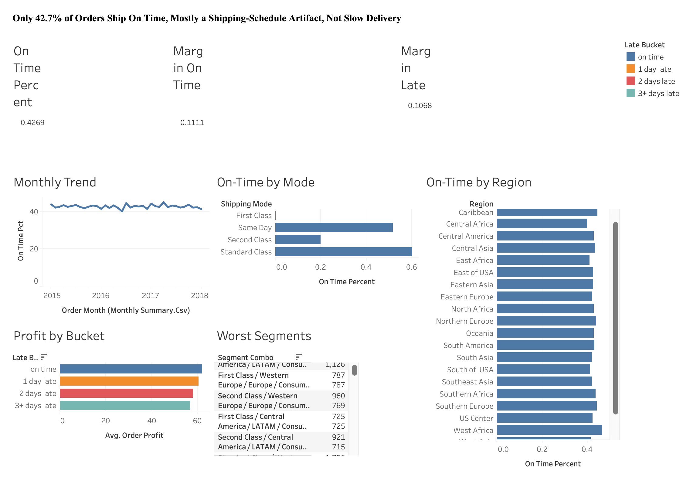

# DataCo Delivery Performance

Finds where scheduled delivery dates are missed and whether it affects profit, across 62,897 DataCo supply-chain orders. Built with SQL (DuckDB) and Tableau Public. Simulated business scenario on public data.

**Dashboard:** [View on Tableau Public](https://public.tableau.com/app/profile/3flow.tide/viz/DataCoDeliveryPerformance/Dashboard1)


## Key results
- 42.7% of orders arrive on time.
- "First Class" shipping is late on 100% of orders in every region, a schedule artifact rather than a real operational pattern.
- Lateness has only a small effect on profit; the ~21% loss-making-order rate is a bigger lever.

Full write-up: [docs/findings.md](docs/findings.md)

## Data
[DataCo Smart Supply Chain dataset](https://data.mendeley.com/datasets/8gx2fvg2k6/5) (CC BY 4.0). Place the CSV in `data/raw/`.

## How to run
```
python3 -m venv .venv && source .venv/bin/activate
pip install -r requirements.txt
python scripts/run_pipeline.py
```

## Repository structure
```
dataco-delivery-service-profit/
├── README.md
├── requirements.txt
├── data/
│   ├── raw/          (gitignored, put the downloaded CSV here)
│   └── processed/    (CSV exports used by Tableau)
├── sql/               01-09, run in order by scripts/run_pipeline.py
├── scripts/run_pipeline.py
├── dashboard/
│   ├── tableau_build_guide.md
│   └── screenshots/
└── docs/findings.md
```
